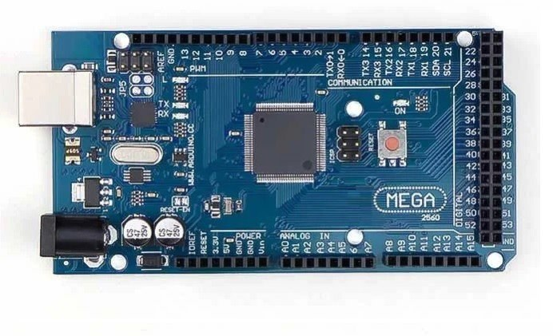
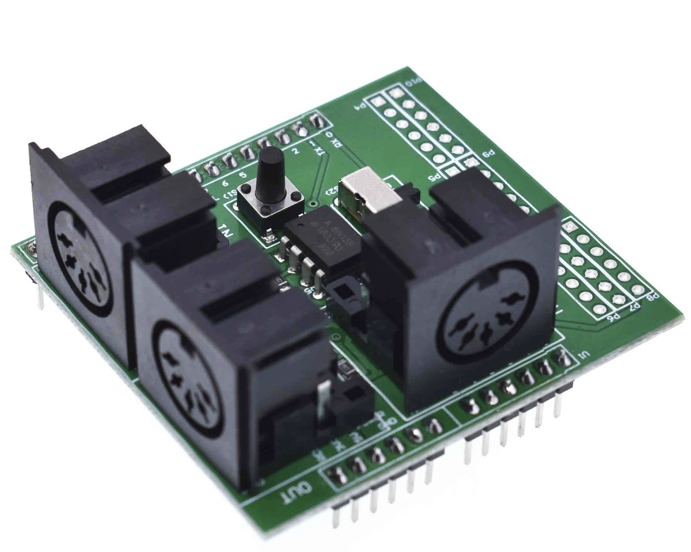

# MIDI Voice Splitter — Arduino Mega 2560

Turns **one MIDI channel into four**. Play a chord and every note goes out on its own MIDI channel, so
gear that is monophonic per track/part plays polyphonically.

|  |  |
|---|---|
| Arduino Mega 2560 | MIDI shield (IN / OUT / THRU) |

## What you need

- Arduino Mega 2560 (an Uno works too)
- MIDI shield with a 6N138 opto input and 5-pin DIN IN/OUT
- 5 male-male dupont wires
- MIDI keyboard, and the gear that will receive the notes

## Wiring

Connect **by name**:

| Arduino | Shield |
|---|---|
| `5V` | `5V` |
| `GND` | `GND` |
| `0 / RX` | `0 / RX` |
| `1 / TX` | `1 / TX` |
| `RESET` | `RESET` *(optional)* |

Keyboard → shield **IN**. Shield **OUT** → your gear (**not** THRU).

> ⚠️ If your board has **female headers** (like the one above), the shield **cannot plug in directly**: it
> sits on top, looks mounted, and makes no contact at all. That is the #1 reason this "doesn't work" —
> hence the dupont wires.

## Install

1. Shield switch → **OFF**
2. Arduino IDE → Board **Arduino Mega or Mega 2560**, Processor **ATmega2560**
3. Open `MIDI_VoiceSplitter_Mega2560/MIDI_VoiceSplitter_Mega2560.ino` and upload
4. Shield switch → **ON**

The switch connects the MIDI input to the RX pin: **OFF to upload, ON to play.**

## How the channels are assigned

Four voices, one per output channel (13–16 by default). Each voice stores its note, velocity, input
channel, output channel and state (held / sustained).

- A **new note** takes the **lowest free output channel** and keeps it until its Note Off.
- A note that is **already sounding keeps its channel**. Nothing is ever reordered or reassigned.
- A **Note Off** always goes out on the channel stored in the voice — never on a different one.
- A **5th simultaneous note is dropped** (no voice stealing by default).
- **Sustain (CC64):** the Note Off is deferred and the voice keeps its channel until the pedal is released.

```
C3 -> ch13        C4 -> ch16      (nothing above moves)
E3 -> ch14
G3 -> ch15
```

Release E3 → its Note Off goes out on **ch14**, and the next new note takes **ch14** (lowest free channel).

## Settings

At the top of the sketch:

| Constant | Default | |
|---|---|---|
| `INPUT_CHANNEL` | `11` | channel the keyboard transmits on |
| `OUTPUT_CH_FIRST` / `OUTPUT_CH_LAST` | `13` / `16` | output channels (= polyphony) |
| `CHORD_WINDOW_MS` | `0` | `0` = immediate; `15` = sort chords by pitch (15 ms latency) |
| `OVERFLOW_MODE` | drop newest | or `OVERFLOW_STEAL_OLDEST` |
| `DEBUG` | `0` | `1` = logs, wrapped in SysEx so MIDI gear ignores them |

## Notes

- Serial monitor at **31250 baud** (MIDI shares D0/D1 with the USB link).
- Upload fails with `stk500v2_getsync` → the shield switch is ON.
- COM port stuck (`cannot set com-state`) → unplug and replug the USB.
- Pitch bend, CC and aftertouch are passed to all four output channels; `0xFF` System Reset is filtered.
- The sketch also has `MODE_THRU`, `MODE_MONITOR` (MIDI analyser) and `MODE_SPLIT_ZONES` (2-zone split).

## License

MIT — see [LICENSE](LICENSE).
